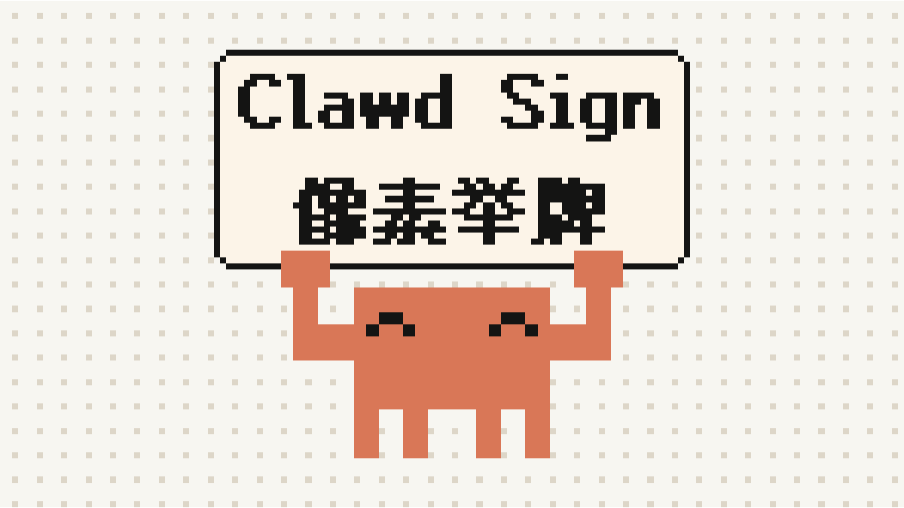

# Clawd 举牌 · Clawd Sign

一只像素小螃蟹替你举牌。牌子上的文字、字体、颜色、表情、背景……全部可以自定义；
文字用真正的像素字体渲染，覆盖中日韩、拉丁、希腊、西里尔、阿拉伯、希伯来、泰文、天城文等几乎所有语言。

A pixel-art crab holding up a sign. Everything is customizable, and the text is drawn with
real pixel fonts that cover almost every writing system.

开源地址 / Source：**<https://github.com/LangYa466/clawd-sign>**



[](https://vercel.com/new/clone?repository-url=https%3A%2F%2Fgithub.com%2FLangYa466%2Fclawd-sign)

## 功能

- **自定义文字**：多行、对齐、字距、行距、像素加粗、文字放大，彩色 Emoji 会被像素化并保留颜色。
- **像素字体 + 超多语言**
  - 缝合像素字体 Fusion Pixel 8 / 10 / 12px：中日韩（可切换简体 / 繁體 / 日本 / 한국 字形）+ 拉丁 / 希腊 / 西里尔。
  - GNU Unifont 16px：覆盖 Unicode 基本平面 5.7 万字；内置阿拉伯文连写（含波斯 / 乌尔都字母和 lam-alef 连字）。
  - 天城文、孟加拉文、泰米尔文、缅甸文、高棉文等需要复杂排版的文字，会用系统字体正确排版后再重新采样成像素。
  - 也可以选「系统字体（像素化）」，或上传自己的 .ttf / .otf / .woff 字体。
  - 字体按 `unicode-range` 拆成几十 KB 的小文件，**只下载当前文字用到的字形**。
- **像素吉祥物**：身体 / 眼睛颜色、6 种表情、自动眨眼、晃动 / 跳跳 / 抖抖动画、1–4 倍大小，也可以隐藏只留牌子。
- **招牌**：底色（也可以设为透明底，只留边框和文字）、边框、文字颜色，边框粗细、像素圆角、留白、最小宽度。
- **背景**：跟随主题、透明（预览区一键切换，导出真·透明 PNG / SVG）、纯色、渐变（可设像素色阶）、图案（棋盘 / 网格 / 圆点 / 斜纹）、上传图片（可像素化、压暗）。
- **画布**：外边距、画布比例（自适应 / 1:1 / 4:3 / 3:4 / 16:9 / 9:16）。
- **9 套配色方案** + 一键随机。
- **主题**：亮色 / 暗色 / 跟随系统，界面和吉祥物默认配色都会跟着切换。
- **导出**：PNG（1–32 倍）、SVG（矢量、带动画）、复制图片到剪贴板、分享链接（设置都编码在链接里）。
- **嵌入**：`?embed=1` 纯净页面，可以直接放进 iframe 或 OBS 浏览器源；也能复制 React 组件代码。
- 中文 / English 界面，设置自动保存在本地。纯前端，所有渲染都在浏览器里完成。

## 部署到 Vercel

项目已经配置好 `vercel.json`，两种方式任选：

1. 点上面的 **Deploy with Vercel** 按钮；或
2. 在 [vercel.com/new](https://vercel.com/new) 导入这个 GitHub 仓库，所有设置保持默认（Framework：Vite，Build：`npm run build`，Output：`dist`），点 Deploy。

之后每次 push 到默认分支都会自动重新部署。

用命令行也可以：

```bash
npm i -g vercel
vercel --prod
```

## 本地开发

需要 Node.js 20.19+ 或 22.12+。

```bash
npm install
npm run dev       # http://localhost:5173
npm run build     # 产物在 dist/
npm run preview
```

`npm run dev` / `npm run build` 会先执行 `scripts/sync-fonts.mjs`，把缝合像素字体从 `node_modules` 复制到 `public/fonts/fusion-pixel/`。

## 在自己的 React 项目里使用组件

把 `src/clawd-sign/` 复制到你的项目，并把 `public/fonts/`（运行一次 `npm run fonts` 后）放到站点的静态目录。

```tsx
import { ClawdSign } from './clawd-sign';

<ClawdSign text="下班了" theme="system" pixelSize={6} />

<ClawdSign
  text={'早上好\nGood morning'}
  theme="dark"
  font="fusion-10"
  eyes="happy"
  animation="bob"
  colors={{ body: '#7fae5b', signFill: '#fbfdf5' }}
  background={{ type: 'pattern', kind: 'dots', color1: '#e8efdc', color2: '#cfdcbc', size: 4 }}
/>
```

字体默认从 `<BASE_URL>fonts/` 加载，放在别处时调用 `setFontBaseUrl('https://cdn.example.com/fonts/')`。

### Props

| 属性 | 类型 | 默认值 | 说明 |
| --- | --- | --- | --- |
| `text` | `string` | `'suspend'` | 牌子上的文字，`\n` 换行 |
| `theme` | `'light' \| 'dark' \| 'system'` | `'system'` | 默认配色跟随的主题 |
| `font` | `'fusion-12' \| 'fusion-10' \| 'fusion-8' \| 'unifont' \| 'system' \| 'custom'` | `'fusion-12'` | 字体 |
| `customFontFamily` / `customFontSize` | `string` / `number` | `''` / `16` | `custom`、`system` 字体的字体名和像素字号 |
| `cjkRegion` | `'auto' \| 'zh_hans' \| 'zh_hant' \| 'ja' \| 'ko'` | `'auto'` | 汉字字形 |
| `fontScale` | `1–4` | `1` | 文字放大倍数 |
| `bold` | `boolean` | `true` | 像素加粗 |
| `align` | `'left' \| 'center' \| 'right'` | `'center'` | 对齐 |
| `letterSpacing` / `lineSpacing` | `number` | `0` / `2` | 字距 / 行距（像素） |
| `colorEmoji` | `boolean` | `true` | Emoji 保留彩色 |
| `threshold` | `1–255` | `110` | 抗锯齿像素算作笔画的阈值 |
| `paddingX` / `paddingY` | `number` | `3` / `3` | 留白 |
| `borderWidth` / `cornerRadius` | `number` | `1` / `1` | 边框粗细 / 像素圆角 |
| `minWidth` | `number` | `0` | 牌子最小宽度 |
| `transparentSign` | `boolean` | `false` | 牌子透明底：只画边框和文字，背景透出来 |
| `showMascot` | `boolean` | `true` | 显示吉祥物 |
| `mascotScale` | `1–4` | `1` | 吉祥物大小 |
| `eyes` | `'square' \| 'tall' \| 'happy' \| 'closed' \| 'wink' \| 'dizzy'` | `'square'` | 表情 |
| `blink` | `boolean` | `true` | 自动眨眼 |
| `animation` | `'none' \| 'bob' \| 'jump' \| 'shake'` | `'none'` | 动画（遵循 `prefers-reduced-motion`） |
| `colors` | `Partial<{ background, signFill, signBorder, text, body, eyes }>` | `{}` | 覆盖主题配色 |
| `background` | 见 `BackgroundSpec` | `{ type: 'theme' }` | `theme` / `transparent` / `color` / `gradient` / `pattern` / `image` |
| `margin` | `number` | `6` | 外边距 |
| `aspect` | `'auto' \| '1:1' \| '4:3' \| '3:4' \| '16:9' \| '9:16'` | `'auto'` | 画布比例 |
| `pixelSize` | `number` | `8` | 每个像素在页面上占多少 CSS 像素 |
| `animate` | `boolean` | `true` | 是否播放动画 |
| `onSceneChange` | `(scene) => void` | – | 场景生成后回调，可用于导出 |

### 不用 React

```ts
import { buildScene, sceneToSvg, sceneToPngBlob, DEFAULT_OPTIONS } from './clawd-sign';

const scene = await buildScene({ ...DEFAULT_OPTIONS, text: 'Hello 世界' }, 'light');
const svg = sceneToSvg(scene, { pixelSize: 10 });   // SVG 字符串
const png = await sceneToPngBlob(scene, 10);         // PNG Blob
```

## 嵌入

编辑器里「嵌入与代码」会生成 iframe 代码，形如：

```html
<iframe src="https://你的域名/?embed=1#<设置>" width="544" height="368" style="border:0;background:transparent"></iframe>
```

背景选「透明」后可以直接作为 OBS 浏览器源使用。

## 实现原理

1. 用 Canvas 按字体的**原生像素字号**画出每一行文字，再按透明度阈值把每个像素判定为「有 / 无」，得到 1-bit 位图。
   像素字体的轮廓本来就对齐像素网格，所以结果和原字体逐像素一致；其它字体则被「像素化」。
2. 文字分别用黑色和白色各画一次：颜色跟着变的是普通笔画，不变的是彩色 Emoji，于是 Emoji 能保留颜色。
3. 每一行先检查字体覆盖范围（读取 `@font-face` 的 `unicode-range`）：缝合像素字体缺字的行整体换成 Unifont；
   需要复杂排版的文字换成系统字体再采样；阿拉伯文先转换成上下文形式（Presentation Forms）再画。
4. 牌子、文字、吉祥物都画进同一张调色板像素网格，按颜色合并成矩形，输出为 `shape-rendering="crispEdges"` 的 SVG，
   任何缩放都保持锐利；PNG 导出直接逐块绘制。

## 目录

```
src/clawd-sign/   组件库：字体加载、文字光栅化、阿拉伯文连写、吉祥物像素图、场景合成、SVG / PNG 渲染
src/app/          编辑器页面
public/fonts/     Unifont 拆分字体（缝合像素字体在构建时复制进来）
scripts/          sync-fonts.mjs（复制字体）、split-unifont.py（重新拆分 Unifont）
```

## 许可证

- 代码：MIT
- [缝合像素字体 Fusion Pixel Font](https://github.com/TakWolf/fusion-pixel-font)（TakWolf，通过 `@vp-tw/cjk-web-fonts-fusion-pixel-font` 的拆分版本）：SIL OFL 1.1
- [GNU Unifont](https://unifoundry.com/unifont/)：SIL OFL 1.1（`public/fonts/unifont/OFL.txt`）
